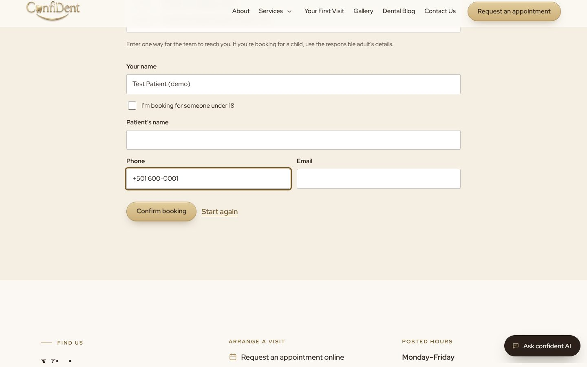
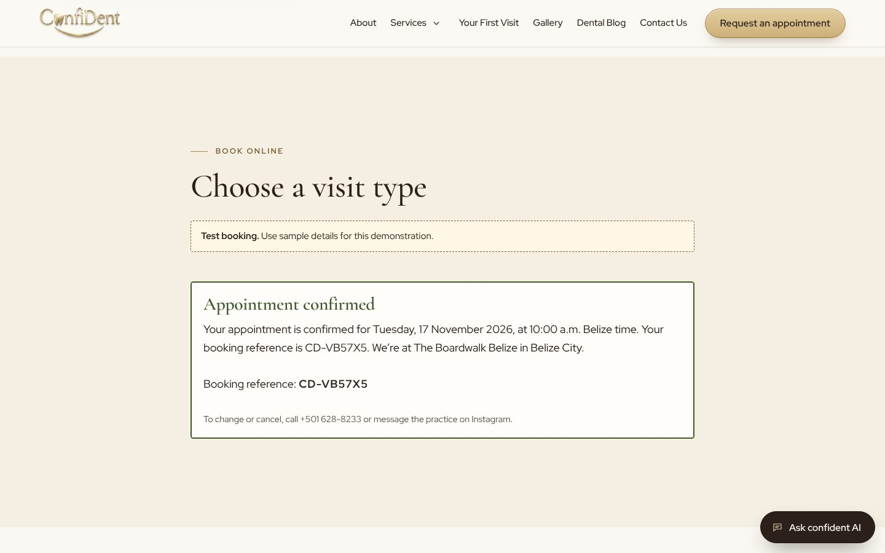
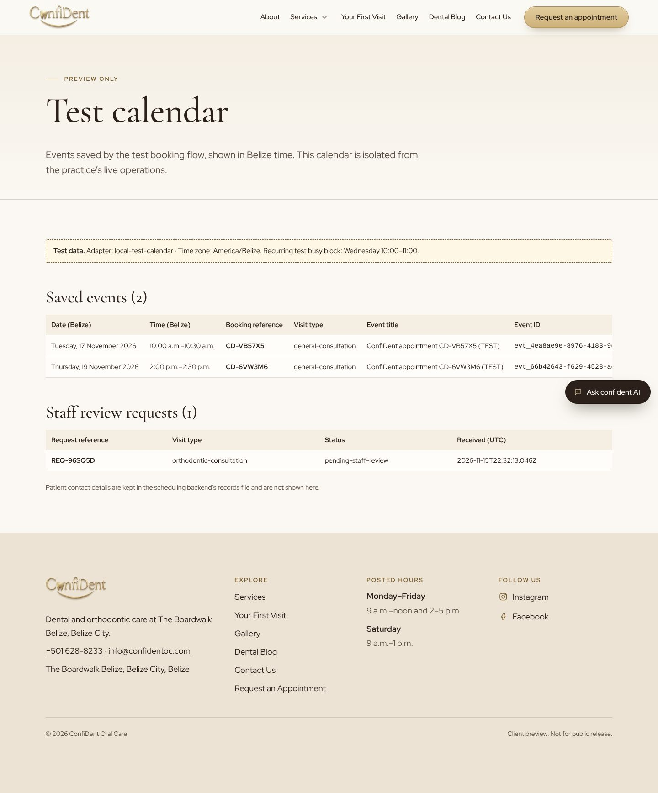
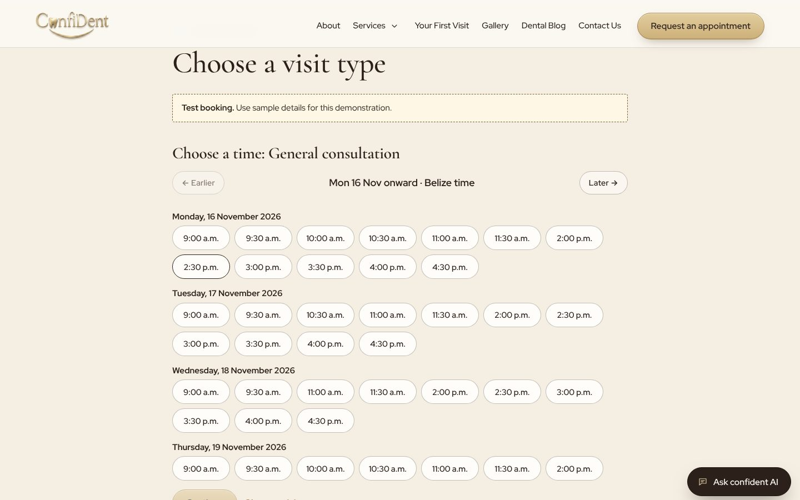
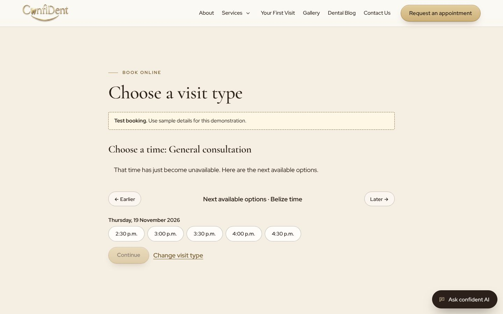
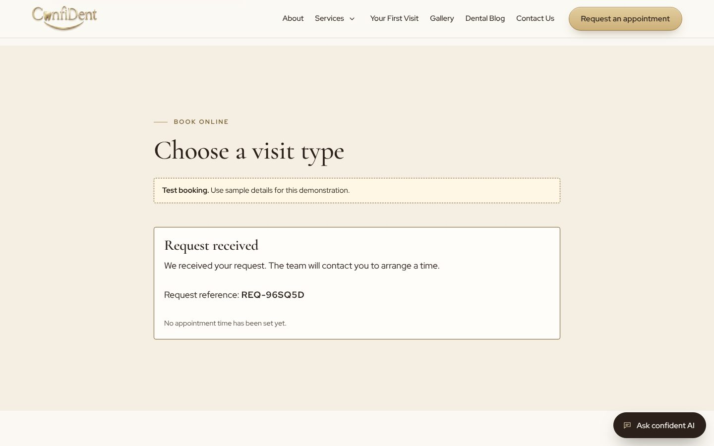
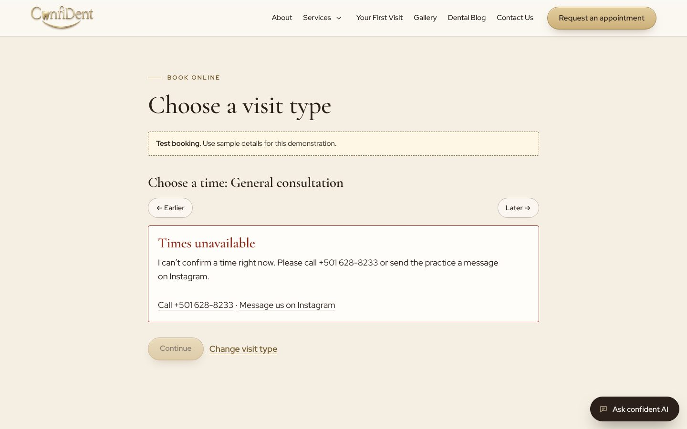
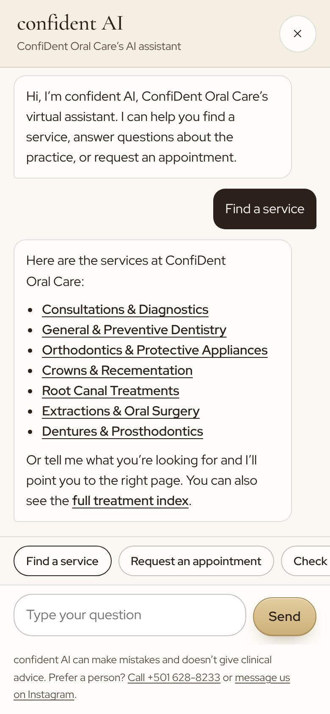

# Preview walkthrough

These screenshots were captured from the running preview (`npm start`) with Playwright on Sunday 15 November 2026, at about 4:30 p.m. Belize time. Every booking uses the **local test calendar** and invented test details. Each screen carries the label “Test booking. Use sample details for this demonstration.”

To reproduce: start the server, open `/appointments`, follow the steps below, then open `/preview/test-calendar`.

## 1. A booking saved to the test calendar

1. On **Appointments → Book online**, choose **General consultation** and select **Continue**.
2. Choose **Tuesday, 17 November 2026 at 10:00 a.m.**, then **Continue**.
3. Enter a test name and phone number and select **Confirm booking**.

The confirmation appears only after the calendar returns an event ID:

> Your appointment is confirmed for Tuesday, 17 November 2026, at 10:00 a.m. Belize time. Your booking reference is CD-VB57X5. We’re at The Boardwalk Belize in Belize City.

### The saved test event

`/preview/test-calendar` lists the saved events in **Belize time**. The 10:00 a.m. booking appears as **Tuesday, 17 November 2026, 10:00–10:30 a.m.**, stored as `2026-11-17T16:00:00Z` (Belize is UTC−6). It has a neutral title and no patient details. The staff-review request from step 3 appears below it with no time.

## 2. Unavailable slots

**Times that are never offered.** The scheduler returns available times only:

- No lunch-hour starts.
- Nothing after the demo cutoff: the last weekday start is 4:30 p.m., and the last Saturday start is 12:30 p.m.
- Nothing within two hours of now.
- Nothing during the recurring test busy block. On Wednesday 18 November, **10:00 and 10:30 a.m. are missing**.
- Once Tuesday's 10:00 a.m. booking is saved, that time disappears from Tuesday's list.

**A slot taken by someone else.** Two separate browser sessions both opened the review step for **Thursday, 19 November at 2:00 p.m.** Session A confirmed first. When session B submitted, the server rechecked the calendar under the resource lock and refused the write. Session B was then shown the next times the scheduler actually has free:

> That time has just become unavailable. Here are the next available options.

Only one event was written for 2:00 p.m. (see the test calendar above). Asking confident AI for a lunch-hour or after-cutoff time works the same way. The availability tool returns only real free times, so the assistant offers the nearest ones it was given.

## 3. A staff-review request

The **Orthodontic consultation** is configured as a staff-review visit type. Choose it and the form skips the time step. Enter test details (here, a parent booking for a child, with “Saturday mornings” as the preference) and select **Send request**:

> We received your request. The team will contact you to arrange a time.

The screen states that no appointment time has been set. The request appears under **Staff review requests** in the test calendar view, with status `pending-staff-review`. No calendar event is created.

## 4. Calendar connection failure

Start the server with `CALENDAR_FAULT=unavailable`. The booking form and confident AI then show the phone and Instagram fallback, and nothing is shown as confirmed:

> I can’t confirm a time right now. Please call +501 628-8233 or send the practice a message on Instagram.

## 5. Mobile and confident AI

At 390 px, the header keeps **Request an appointment** visible. The hero text moves to a panel below the photo, so the signage and reception desk stay clear. The **Ask confident AI** launcher opens a full-height panel that resizes with the on-screen keyboard. The four suggested actions are **Find a service**, **Request an appointment**, **Check opening hours** and **Get directions**. Each has a real destination. The phone and Instagram options stay in the panel footer.

With `ANTHROPIC_API_KEY` set, typed questions go to Claude. A booking request runs as follows:

1. Claude calls `find_available_times`.
2. It offers a handful of the returned Belize times.
3. It calls `open_booking_form` for the time the visitor picks.
4. The same review-and-confirm form shown above appears inside the chat.
5. The visitor enters their own details there and confirms, and the server writes the booking.

The live Claude conversation wasn't captured here because the build environment had no API key. The tool loop is covered by `tests/assistant.test.mjs`.
